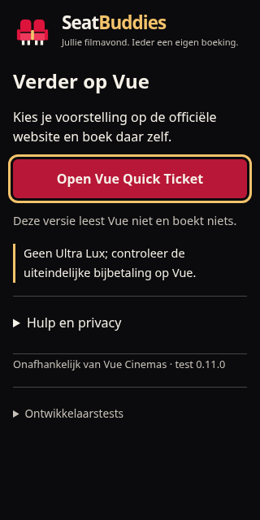
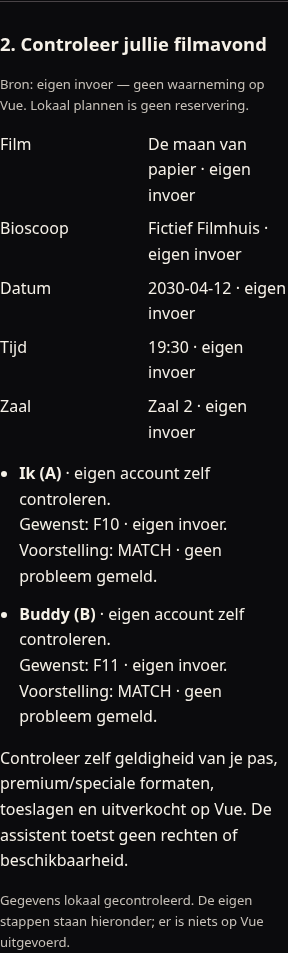
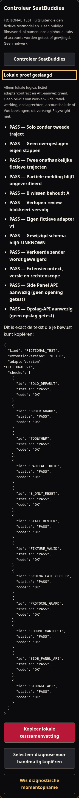

# SeatBuddies — compacte start 0.11.0-test

[ADR-010](decisions/ADR-010-product-shell-reboot.md): één officiële Quick Ticket-link, nul verplichte velden, korte ZERO EXTRA-regel, gesloten Hulp/privacy en Ontwikkelaarstests. Geen lege A/B-kaarten, technische broncodes of lange checklist als standaard. Geteste breedtes320/360/420, volledig boven de vouw bij640px hoogte. Toetsenbordfocus zichtbaar op de primaire link.

Werkelijke lokale Chromium-rendererfoto met fictieve/geen gegevens, geen marketingmockup of menselijke Mac-acceptatie. Hieronder de historische ontwerpafspraken/beelden voor optionele ontwikkelaartools; deze zijn niet meer de standaardstart.

# SeatBuddies — visuele afspraken 0.7.0-test

Twee originele, vereenvoudigde bioscoopstoelen vormen het merk: eigen crimson silhouetten, één warme gouden armleuning en een charcoal ondergrond. Geen Vue-/Netflix-logo, externe merkasset, webfont of glow. De naam en beschrijvende tekst vormen het compacte woordmerk; naam-/merkrechten voor publicatie zijn nog niet beoordeeld.

| Token          | Waarde  | Gebruik                                                   |
| -------------- | ------- | --------------------------------------------------------- |
| Background     | #0B0B0D | Browser-owned popup/paneel                                |
| Surface        | #15161B | Kaarten en formulierachtergrond                           |
| Ivory          | #F6F1E8 | Primaire tekst                                            |
| Muted          | #C7C1B9 | Hulptekst, nog steeds leesbaar                            |
| Crimson        | #DC143C | Merkicoon, decoratie                                      |
| Crimson button | #B81738 | Donkerdere primaire knop voor lichte tekst                |
| Gold           | #F4C36B | Accent, focus en expliciete selectie; geen boekingsbewijs |

De bron is [public/icons/seatbuddies.svg](../public/icons/seatbuddies.svg). `npm run icons` rasteriseert met de vastgelegde dev-only resvg-versie naar 16/32/48/128px PNG; `npm run icons:check` vergelijkt de exacte gegenereerde bytes. Zowel manifest als action gebruiken die lokale bestanden. Kleine iconen hebben twee duidelijke zittingen en geen tekst of fijn patroon. SVG en de 16/128px PNG zijn daadwerkelijk bekeken.

Geen status wordt groen omdat een bijnaam is gekozen. Geselecteerd, eigen controle, browsercontext en UNKNOWN houden hun eigen tekstuele betekenis. Nieuwe-buddybevestiging is een toetsenbordbereikbare groep met focus op de uitleg; nicknamevelden hebben labels, foutmelding en beperkte lengte. De primaire popupknop staat boven de lijst en blijft ook zonder buddy beschikbaar. Lange lijsten mogen verticaal scrollen. Het paneel en de lokale fixture worden op 320px gecontroleerd. Systemfonts, zichtbare focus, reduced-motion-regels en gewone semantische formulieren beperken onnodige complexiteit.

Het widgetontwerp is uitsluitend op de verpakte fictieve pagina te zien, met eigen scoped kaartstijlen en **DEMO · NIET GEBOEKT · GEEN VUE INTEGRATIE**. Vue-reactiviteit handelt fictieve schermstappen en verdwijnen/herplaatsen af; er wordt geen echte website geobserveerd.

Zie [feasibility](feasibility.md) voor werkelijk uitgevoerde visuele-/browsertests. Renderer-screenshots zijn bewijs van de fictieve gebouwde interface, geen echte Vue-integratie of menselijk Mac-bewijs. VoiceOver en de menselijke Mac-proef volgen na de bouw.

Daadwerkelijk gemaakte en bekeken, geschoonde rendererbeelden (fictieve data, transportdouble):

Ook het [eerder gemaakte fictieve widgetbeeld](images/seatbuddies-widget.png) blijft beschikbaar als historische rendererreferentie.

## Movie Night HQ

Het Filmavond-overzicht is de eerste hoofdkaart: eigen voorstelling, alleen actieve compacte onafhankelijke trajecten, één rustige gouden vervolgstap en twee schematische eigen stoelcodes. Geen officiële plattegrond of beschikbaarheidskleur. CONSECUTIVE_UNVERIFIED blijft expliciet ongeverifieerd; een afgeronde eigen melding blijft NOT SITE VERIFIED. Plan → Review → Eigen stappen ordent de bestaande vijf eigen stappen.

Privacy staat bij buddybeheer, standaard uit, met volledige uitleg en een door Chrome bevestigde checkbox. Conceptopslag staat afzonderlijk onder een details-element: expliciet bewaren/herstellen/wissen, geen achtergrondautosave. Herstelde invoer heeft een opvallend Concept, opnieuw controleren-label. Bron-/fout-/empty-/onbeschikbaarheidsteksten zijn producttaal; protocolcodes staan alleen waar ze bewijs verduidelijken.

## Projector Ready

Solo en samen zijn afzonderlijke expliciete, toetsenbordbedienbare plankeuzes met tekst én aria-pressed. De nieuwe review hergebruikt de bestaande invoerformulieren, toont eigen bronlabels en laat onbekende zaal/stoelvelden UNKNOWN. Bevestiging voor solo verplaatst focus naar de uitleg en wist uitsluitend B na keuze; het overzicht blijft direct leesbaar. Hersteladvies na gedeeltelijke uitkomst gebruikt rustige openklapbare menselijke instructies. Review leidt naar de eerstvolgende nog open eigen stap; diagnosepreview krijgt focus en blijft selecteerbaar. Een aparte stabiele live-regio volgt betekenisvolle tekst, nooit snapshotidentiteit of doorlopende leeftijd. Fouten gebruiken alert, gewone polling maakt geen nieuwe aankondiging. Alle knoppen/summaries hebben minimaal 44px aanraakhoogte; de bestaande gold focus, niet-kleurgebonden statussen en reduced-motion blijven.

Popup/HQ/preflight-beelden zijn bij de Sprint 07-controle daadwerkelijk gemaakt, bekeken en vernieuwd; het widgetbeeld blijft historische referentie. Geen native Mac- of live Vue-screenshotclaim.

Ook de lokale review is werkelijk vastgelegd en bekeken (fictieve invoer, renderer):

## First-Run Forge

De hoofdroute toont direct solo/samen en bij een leeg plan de gewenste stoelen in hetzelfde formulier. Review en eigen stappen blijven dezelfde schermdelen; geen wizard. Technische simulatie is verplaatst naar bestaande diagnostiek. De fictieve proeflink en korte startuitleg gebruiken bestaande details-elementen. V-show houdt onopgeslagen formulieren bij technische viewwissels in leven; workerherstel onderscheidt zichtbaar concept van feitelijke voortgang.

De nieuwe lokale proef staat in dezelfde diagnostiek, duidelijk FICTIONAL_TEST. Geen groen account-/boekingssucces: tekstuele PASS/FAIL/NOT_TESTED en scope staan bij elk resultaat. De preview hergebruikt de gewone diagnosekopieerder. Ook op 320px blijven de vaste technische codes leesbaar via de bestaande selecteerbare preview. Onderstaand beeld is daadwerkelijk gerenderd en bekeken met fictieve data en een **transportdouble**; het bewijst geen native Chrome-API-werking.

Popup/HQ/preflight-afbeeldingen hierboven zijn vernieuwd vanuit de 0.7.0-UI-suite. Het widgetbeeld blijft historisch. Native en menselijke status staan uitsluitend in feasibility; de [UX-audit](ux-friction-audit.md) geeft de werkelijk gemeten route.
