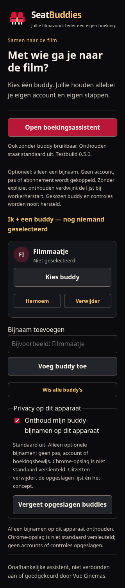
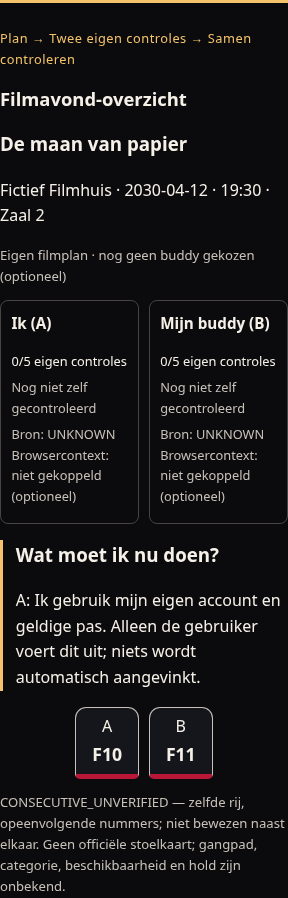

# SeatBuddies — visuele afspraken 0.5.0-test

Twee originele, vereenvoudigde bioscoopstoelen vormen het merk: eigen crimson silhouetten, één warme gouden armleuning en een charcoal ondergrond. Geen Vue-/Netflix-logo, externe merkasset, webfont of glow. De naam en beschrijvende tekst vormen het compacte woordmerk; naam-/merkrechten voor publicatie zijn nog niet beoordeeld.

| Token          | Waarde  | Gebruik                                                   |
| -------------- | ------- | --------------------------------------------------------- |
| Background     | #0B0B0D | Browser-owned popup/paneel                                |
| Surface        | #15161B | Kaarten en formulierachtergrond                           |
| Ivory          | #F6F1E8 | Primaire tekst                                            |
| Muted          | #C7C1B9 | Hulptekst, nog steeds leesbaar                            |
| Crimson        | #DC143C | Merkicoon, decoratie                                      |
| Crimson button | #B81738 | Donkerdere primaire knop voor lichte tekst                |
| Gold           | #F4C36B | Accent, focus en expliciete selectie; geen boekingsbewijs |

De bron is [public/icons/seatbuddies.svg](../public/icons/seatbuddies.svg). `npm run icons` rasteriseert met de vastgelegde dev-only resvg-versie naar 16/32/48/128px PNG; `npm run icons:check` vergelijkt de exacte gegenereerde bytes. Zowel manifest als action gebruiken die lokale bestanden. Kleine iconen hebben twee duidelijke zittingen en geen tekst of fijn patroon. SVG en de 16/128px PNG zijn daadwerkelijk bekeken.

Geen status wordt groen omdat een bijnaam is gekozen. Geselecteerd, eigen controle, browsercontext en UNKNOWN houden hun eigen tekstuele betekenis. Nieuwe-buddybevestiging is een toetsenbordbereikbare groep met focus op de uitleg; nicknamevelden hebben labels, foutmelding en beperkte lengte. De primaire popupknop staat boven de lijst en blijft ook zonder buddy beschikbaar. Lange lijsten mogen verticaal scrollen. Het paneel en de lokale fixture worden op 320px gecontroleerd. Systemfonts, zichtbare focus, reduced-motion-regels en gewone semantische formulieren beperken onnodige complexiteit.

Het widgetontwerp is uitsluitend op de verpakte fictieve pagina te zien, met eigen scoped kaartstijlen en **DEMO · NIET GEBOEKT · GEEN VUE INTEGRATIE**. Vue-reactiviteit handelt fictieve schermstappen en verdwijnen/herplaatsen af; er wordt geen echte website geobserveerd.

Zie [feasibility](feasibility.md) voor werkelijk uitgevoerde visuele-/browsertests. Renderer-screenshots zijn bewijs van de fictieve gebouwde interface, geen echte Vue-integratie of menselijk Mac-bewijs. VoiceOver en de menselijke Mac-proef volgen na de bouw.

Daadwerkelijk gemaakte en bekeken, geschoonde rendererbeelden (fictieve data, transportdouble):

Ook het [eerder gemaakte fictieve widgetbeeld](images/seatbuddies-widget.png) blijft beschikbaar als historische rendererreferentie.

## Movie Night HQ

Het Filmavond-overzicht is de eerste hoofdkaart: eigen voorstelling, twee compacte onafhankelijke trajecten, één rustige gouden vervolgstap en twee schematische eigen stoelcodes. Geen officiële plattegrond of beschikbaarheidskleur. CONSECUTIVE_UNVERIFIED blijft expliciet ongeverifieerd; een afgeronde eigen melding blijft NOT SITE VERIFIED. Plan → Twee eigen controles → Samen controleren ordent de bestaande vijf eigen stappen.

Privacy staat bij buddybeheer, standaard uit, met volledige uitleg en een door Chrome bevestigde checkbox. Conceptopslag staat afzonderlijk onder een details-element: expliciet bewaren/herstellen/wissen, geen achtergrondautosave. Herstelde invoer heeft een opvallend Concept, opnieuw controleren-label. Bron-/fout-/empty-/onbeschikbaarheidsteksten zijn producttaal; protocolcodes staan alleen waar ze bewijs verduidelijken.
