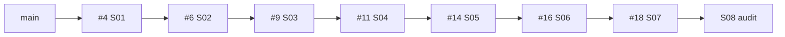

# Integration Forge — gereedheid van de gezamenlijke boom

**22 oktober 2026 · AI-assisted technische review.** Opgehaald van de echte remote; alle zeven PR’s zijn nog Draft/open en ongewijzigd. Basis Sprint 07 `3209eeed7940c47a44dc1045ea1930e7530fc36d`. Auditbranch `feat/issue-19-sprint-08`, codecommit `cdbeb1c574ccc5d12f7bf60ef33287f758b0cad4`. Geen merge, retarget, branchverwijdering, tag, release, deployment of Storepublicatie op GitHub uitgevoerd.

## PR-keten, exacte heads/bases/trees

De base-SHA hieronder is de huidige tip van de zichtbare base-branch, geen verzonnen GitHub merge-ref. PR-pagina’s bevestigen namen/status; `git fetch` haalde iedere refs/pull/N/head afzonderlijk op. GitHub API-mergeable/protection-velden: **INCONCLUSIVE / API Forbidden**. Lokaal conflictvrij integreren is apart bewezen, geen vervanging voor GitHub-required-checks.

| Sprint / PR                                                 | Headbranch                | Head-SHA                                   | Huidige base-SHA                           | Tree-SHA                                   | Laatste waargenomen CI/status                                                                                                                       |
| ----------------------------------------------------------- | ------------------------- | ------------------------------------------ | ------------------------------------------ | ------------------------------------------ | --------------------------------------------------------------------------------------------------------------------------------------------------- |
| 1 / [#4](https://github.com/johndobry89/SeatBuddy/pull/4)   | `feat/issue-3-sprint-01`  | `b2be53ee40d756da1a68b5455d5ab3f81fe36074` | `c0c5c1b0f683b003288ca33eed8ad5d9b9e08825` | `5f08e860ad560aee06c68dbaeaa6457f295af19b` | Draft/open; [run 39389132288](https://github.com/johndobry89/SeatBuddy/actions/runs/39389132288): SUCCESS                                           |
| 2 / [#6](https://github.com/johndobry89/SeatBuddy/pull/6)   | `feat/issue-5-sprint-02`  | `c4b72b49fcde06b41568a6e660866d5e6c903b27` | `b2be53ee40d756da1a68b5455d5ab3f81fe36074` | `1ae40949aa76edc68c218aef565a0faf853b725e` | Draft/open; [run 39397119724](https://github.com/johndobry89/SeatBuddy/actions/runs/39397119724): SUCCESS                                           |
| 3 / [#9](https://github.com/johndobry89/SeatBuddy/pull/9)   | `feat/issue-7-sprint-03`  | `383d79d1260fdb0fdc4df0e8dd4ebb2407146a53` | `c4b72b49fcde06b41568a6e660866d5e6c903b27` | `39722d5033c63ed911573acfd2b2eeedf02b3bf3` | Draft/open; [run 39571010731](https://github.com/johndobry89/SeatBuddy/actions/runs/39571010731): FAILURE: Linux PASS, Mac CANCELLED/niet verkregen |
| 4 / [#11](https://github.com/johndobry89/SeatBuddy/pull/11) | `feat/issue-10-sprint-04` | `61c7fcaeec8dbebadb2244a224e4d682b1e4acf6` | `383d79d1260fdb0fdc4df0e8dd4ebb2407146a53` | `27b5993dd417ea06142505149c48107e7fe8d43d` | Draft/open; [run 39589428049](https://github.com/johndobry89/SeatBuddy/actions/runs/39589428049): SUCCESS                                           |
| 5 / [#14](https://github.com/johndobry89/SeatBuddy/pull/14) | `feat/issue-12-sprint-05` | `129f84e3c2fd9d802217214a44864ef56354c522` | `61c7fcaeec8dbebadb2244a224e4d682b1e4acf6` | `aaad705cfb6d1aea1aab81b9c3c7639c9f28ea43` | Draft/open; [run 39614754412](https://github.com/johndobry89/SeatBuddy/actions/runs/39614754412): SUCCESS                                           |
| 6 / [#16](https://github.com/johndobry89/SeatBuddy/pull/16) | `feat/issue-15-sprint-06` | `40fee3dea7ce3ef5db79e667f93af3903dca8d9c` | `129f84e3c2fd9d802217214a44864ef56354c522` | `af14ef89e448c84d8800155b40172d35c5150823` | Draft/open; [run 39624674807](https://github.com/johndobry89/SeatBuddy/actions/runs/39624674807): SUCCESS                                           |
| 7 / [#18](https://github.com/johndobry89/SeatBuddy/pull/18) | `feat/issue-17-sprint-07` | `3209eeed7940c47a44dc1045ea1930e7530fc36d` | `40fee3dea7ce3ef5db79e667f93af3903dca8d9c` | `92bcdf66dfa779caa01e24aa93384bcebd08aa9a` | Draft/open; [run 39743899891](https://github.com/johndobry89/SeatBuddy/actions/runs/39743899891): SUCCESS                                           |

`main` = `c0c5c1b0f683b003288ca33eed8ad5d9b9e08825`, tree `dfa073693be6dd8ecbb134d8f5f3ba7829090189`. Sprint 07 is **30 commits vooruit, 0 achter**, 121 gewijzigde bestanden ten opzichte van main. Iedere PR-base is voorouder van zijn head; de bronhistorie is lineair. De auditcommit heeft uitsluitend Sprint 07 als parent en bevat geen gepubliceerde rehearsal-mergecommits. Latere documentatiecommits staan op dezelfde auditbranch; hun exacte uiteindelijke SHA en CI horen bij de oplevering.

## CI: afwijkingen en grenzen

De latest PR-triggered workflows zijn afzonderlijk opnieuw gelezen, inclusief publieke jobannotaties. #4 is alleen Linux (oude skeletsuite). #6: Linux 4 UI/2 native. **#9 is rood**, 15m02s: Linux 5 UI/2 native geslaagd, macos-latest niet door hosted runner verkregen, internal server error en arm64-capaciteitswaarschuwing; geen Mac-tests uitgevoerd. Niet als hele workflow PASS gerapporteerd. #11: 7 UI per platform/3 Linux-native. #14: 9 UI per platform/5 Linux-native. #16: 12 UI per platform/6 Linux-native. #18: 19 UI per platform/7 Linux-native/2 Mac-native smoke, SUCCESS. Deze PR-runs gebruiken een GitHub PR-trigger; hun runner-checkout kan een gegenereerde merge-ref zijn, niet automatisch identiek aan de bron-head-SHA.

S07 push-run [39633808060](https://github.com/johndobry89/SeatBuddy/actions/runs/39633808060) is het afzonderlijke directe bewijs op exact head 3209eee. De mislukte S07-run 39631035172 staat als historische keyboard-fout met reparatie in feasibility; S08 voegt geen stille omzetting van die fout naar PASS toe. De oudere S03-documentatie meldde aanvankelijk QUEUED; de inmiddels definitieve uitkomst is FAILURE/CANCELLED, niet langer pending. Er is niets opnieuw uitgevoerd of gewijzigd op de zeven ouderbranches.

S08 code-run [39747432592](https://github.com/johndobry89/SeatBuddy/actions/runs/39747432592) op cdbeb1c is **SUCCESS**, beide platformjobs afgerond: 21 UI per platform, zeven Linux-native en twee Mac-native smoketests uit de gecontroleerde ZIP; install/check/unit/icon/build/package verplicht geslaagd, artifact aanwezig. Final-head CI wordt afzonderlijk gecontroleerd. Native tests gebruiken vanaf S08 uitsluitend de checksum-gecontroleerde, eigen uitgepakte ZIP.

## Oppervlakte- en afhankelijkheidskaart

| Oppervlakte          | Bestaande implementatie                                                | Onderzochte grens / S08-effect                                                                                 |
| -------------------- | ---------------------------------------------------------------------- | -------------------------------------------------------------------------------------------------------------- |
| Popup                | `src/popup`, BuddyManager/RetentionControls                            | Smalle typed buddyview, eigen gesture naar Side Panel; geen film-/A-B-/incognitodata                           |
| Side Panel           | `App.vue`, ManualTrack, MovieNightHQ, PreflightReview                  | Eén planbron, expliciet solo/samen, lokale review en vijf eigen stappen; reset/conceptregressies hersteld      |
| MV3-worker           | `background/index`, coordinator, session-registry                      | Vluchtig, geen bewijsherstel/replay; zender, resetbarrière, generatie/revisie/B-epoch                          |
| Messaging/provenance | `privacy/protocol`, `normal-context`, `chrome/ui-document`             | Bounded strict schema’s; Chrome document-/vensterbewijs, normale fallback; onduidelijke spanning weigeren      |
| Retentie             | `background/retained-data`, `core/retained-data`                       | Trusted-contexts vóór opslag, expliciete opt-in, alleen nickname/ID en vieruurconcept; nieuwe live-clock toets |
| Fixture/adapter      | `fixtures`, `content/fixture-observer`, `adapters/vue-cinemas`         | Alleen verpakte fictieve DOM; productionPolicy blijft hard OFF, geen site-injectie                             |
| Zelftest/diagnose    | `self-test`, DiagnosticsPanel/Preview, `privacy/manifest`              | Geïsoleerde modellen, allowlist/clipboard; gewone diagnose en proef delen strikte rechtenscope                 |
| Manifest/build       | `public/manifest`, Vite, scripts/package/audit-runtime/runtime-notices | Alleen sidePanel/storage, spanning, CSP, lokale assets, twee licentiebestanden en ZIP-bytecontrole             |
| Tests/CI             | `tests/unit`, UI/native Playwright, ci.yml                             | 239 unit, 21 UI; 7 Linux-native en 2 Mac-smokes behouden; native bron nu verpakt archief                       |
| Documentatie         | masterplan, ADR’s, feasibility, Mac/Windows/privacy/QA                 | Ontwerp versus bewijs gescheiden; eerdere claims niet opgewaardeerd; eigenaaracceptatie blijft NOT_RUN         |

## Acceptatie per functie — gezamenlijk HEAD

Onderstaande lokale tests draaien de complete boom. Renderer-doubles zijn geen Chrome API-bewijs. Native daadwerkelijke platformuitslagen moeten uit de genoemde CI-run/job komen; lokale native pogingen zijn BLOCKED door beheerbeleid.

| Functie / criterium                                  | Test-ID / opdracht                                                          | Resultaat en bewijsscope                                                                                                |
| ---------------------------------------------------- | --------------------------------------------------------------------------- | ----------------------------------------------------------------------------------------------------------------------- |
| Installatie/build, permissies/CSP/iconen             | `npm ci`, `npm run check`, `tests/unit/package.test.mjs`, `npm run package` | PASS lokaal; MV3 0.8.0, precies sidePanel/storage, spanning, rootmanifest, 16/32/48/128px, runtimeallowlist en notices  |
| SOLO/TOGETHER, review en onafhankelijke vijf stappen | `tests/unit/projector.test.ts`, UI Projector Ready / friction audit         | PASS lokaal; budget 14 solo/22 samen behouden, geen echte boeking                                                       |
| Mismatch/ontbrekende zaal/stoelen/partiële uitkomst  | manual/movie-night/core/adapter tests + UI built/manual flow                | PASS lokaal op fictieve/eigen invoer; websiteproof UNKNOWN                                                              |
| B-only reset bij buddywisseling                      | buddies/projector/worker-tests, UI popup CRUD / review regression           | PASS lokaal; A blijft, B leeg; bijnaam is geen account                                                                  |
| Onthouden/vergeten, fout bij wissen                  | retention/worker-tests, UI Movie Night HQ                                   | PASS in memory-/Chrome-doubles; echte opslag/workerstop heeft aparte native suite                                       |
| TTL/corrupt/te groot/future/worker-await             | retention + nieuwe worker-clocktests                                        | PASS, inclusief daadwerkelijk vóór/na gereproduceerde vervaldatumfout; geen oud bewijs hersteld                         |
| Async race/reset/stale/B-epoch/transporttimeout      | worker/companion/normal-context-tests                                       | PASS lokaal; geen herhaling van mutaties; offline planner blijft bruikbaar                                              |
| Incognitoherkomst en normale vensterfallback         | normal-context/worker, native spanning Chrome-cases                         | Unit PASS; lokale native BLOCKED. Geen live accountisolatie of uniform incognito-Side-Panelbewijs                       |
| FICTIONAL_TEST blijft geïsoleerd                     | self-test unit/UI + native First-Run Forge                                  | Unit/UI PASS; geen echte userstate/storage/tabs getest door de ingebouwde proef                                         |
| Diagnose/clipboard/toetsenbord/320px/reduced motion  | diagnostics unit + UI copy/reconnection/Projector Ready                     | PASS lokaal; menselijke VoiceOver NOT_RUN                                                                               |
| Begin opnieuw / cross-worker clear                   | twee nieuwe Integration Forge UI-cases                                      | FAIL vóór reparatie, PASS erna, B behouden bij A-reset                                                                  |
| Werkelijke verpakte installatie                      | `npm run test:e2e` / `test:smoke:chrome` + packaged-extension helper        | Archiefextractie/hash/path/manifest unit PASS; lokale installatie BLOCKED. Linux/Mac-native uitkomst afzonderlijk in CI |
| Menselijke Mac/Windows/arm64, echte Vue, Store       | QA-kaart / G0-/publicatiegate                                               | NOT_RUN / NOT VERIFIED, geen retrospectieve acceptatie uit automatische fixtures                                        |

## Integratieproef en oordeel

Beide routes zijn daadwerkelijk lokaal in losgekoppelde wegwerpworktrees uitgevoerd: sequentieel acht no-ff-stappen en één cumulatieve no-ff-stap vanaf dezelfde main. Iedere tussenboom is exact de bijbehorende head-tree; beide eindbomen zijn **34654e43d79e0b789f1b1951f6db01a53ed2c8f8**, gelijk aan codehead cdbeb1c. De sequentiële gecombineerde boom heeft frozen install/check/239 unit/package én 21 UI-tests PASS. Het gegenereerde archief is bytegelijk aan de featurebuild. Meer: [merge-plan](merge-plan.md).

**Technisch oordeel: GO** voor de geteste handmatige/fictieve eindboom en een toekomstige cumulatieve integratiereview: lokale integratieproef, volledige unit/UI/package en tweeplatform-native-CI geslaagd. De definitieve documentatie-head krijgt een eigen run en wordt in de oplevering per SHA gecontroleerd. Dit GO is geen toestemming om nu te mergen; nieuwe main-target-checks/protection en eigenaarbesluit blijven nodig. **Blind sequentieel oude PR’s mergen: NO-GO** zolang #9 rood is en de opnieuw getargete main-checks niet zijn gehaald. **Publieke distributie/release: NO-GO**: menselijke acceptatie, juridische/merk-/Storevoorwaarden, G0 en expliciete publicatietoestemming ontbreken. Alle merge-/publicatietoestemming is NOT_GRANTED; deze sprint voert uitsluitend voorbereiding uit.
